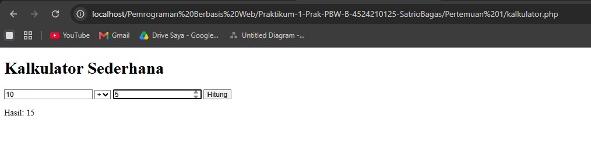
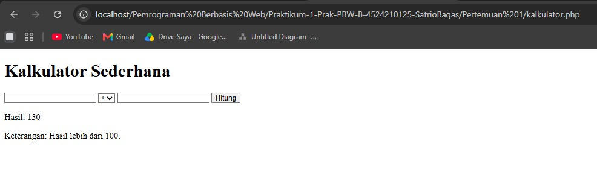
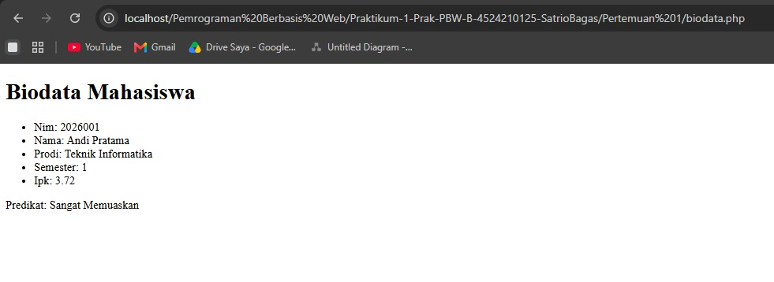
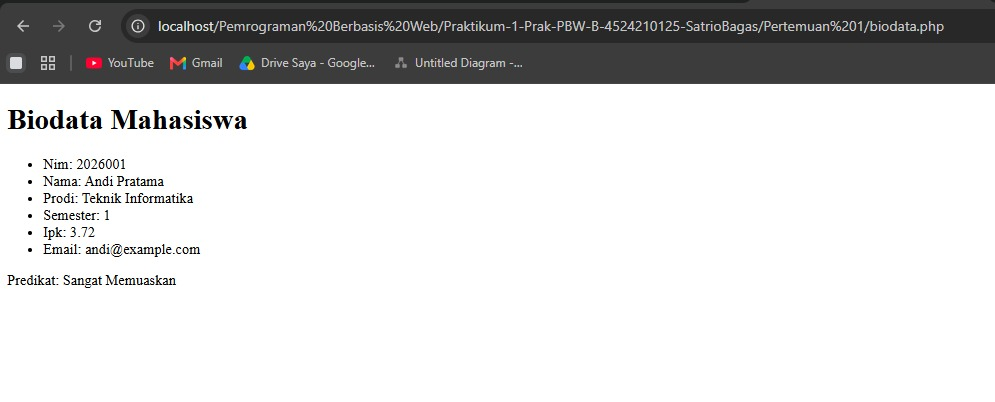

# Tugas 1 Praktikum Pemrograman Berbasis Web

## Identitas

**Nama:** Satrio Bagaskoro  
**NIM:** 4524210125  
**Mata Kuliah:** Pemrograman Berbasis Web

## 1. Program Pertemuan 1

Program yang digunakan:

- `kalkulator.php`
- `biodata.php`

Kedua program berhasil dijalankan menggunakan PHP melalui localhost.

## 2. Modifikasi Program

### Modifikasi 1 - Penambahan Field Email

Pada `biodata.php` ditambahkan field baru berupa email pada data mahasiswa.

```php
'email' => 'andi@example.com'
```

Field email kemudian ditampilkan bersama data mahasiswa lainnya.

### Modifikasi 2 - Penambahan Kondisi

Pada `kalkulator.php` ditambahkan kondisi baru berdasarkan hasil perhitungan.

Jika hasil perhitungan lebih dari 100, program menampilkan keterangan:

```text
Keterangan: Hasil lebih dari 100.
```

Jika hasil perhitungan 100 atau kurang, program menampilkan:

```text
Keterangan: Hasil 100 atau kurang.
```

## 3. Lima Bagian Kode Penting

1. **Variabel** digunakan untuk menyimpan data yang akan diproses oleh program.

2. **Array mahasiswa** digunakan untuk menyimpan data biodata mahasiswa seperti NIM, nama, prodi, semester, IPK, dan email.

3. **Switch** digunakan untuk menentukan operasi matematika berdasarkan operator yang dipilih.

4. **Foreach** digunakan untuk menampilkan setiap data mahasiswa dari array.

5. **If** digunakan untuk membuat kondisi, seperti menentukan keterangan berdasarkan hasil perhitungan.

## 4. Error dan Cara Perbaikan

Error yang pernah muncul adalah halaman **404 Not Found** saat membuka file PHP.

Penyebabnya adalah alamat URL atau lokasi folder file tidak sesuai dengan lokasi file pada localhost.

Cara memperbaikinya adalah memastikan file berada di dalam folder `htdocs` dan menggunakan URL localhost sesuai dengan struktur folder tempat file disimpan.

## 5. Screenshot

### Kalkulator Sebelum Modifikasi



### Kalkulator Sesudah Modifikasi



### Biodata Sebelum Modifikasi



### Biodata Sesudah Modifikasi



## 6. Kesimpulan

Program PHP berhasil dijalankan melalui localhost. Modifikasi berupa penambahan field email dan kondisi baru berhasil diterapkan tanpa menghilangkan fungsi utama program.